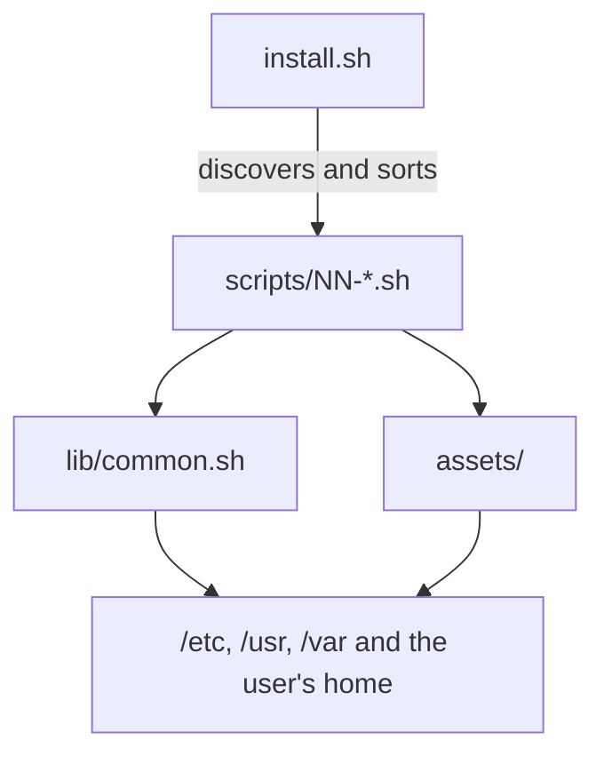

# Architecture and steps

[Português](arquitetura.md) · [English](arquitetura.en.md)

omyfedora is a **suite of idempotent bash scripts** — there is no compiled code, package or
build. `install.sh` is the orchestrator; `lib/common.sh` holds the helpers; each
`scripts/NN-*.sh` is a step; and `assets/` is the source of truth for installed files.

## Execution flow



`install.sh` runs the steps in lexicographic order. To add a step, just create
`scripts/60-foo.sh`; it enters the flow automatically.


## Repository structure

```text
install.sh              # orchestrator: flags, sudo, step order, state
bootstrap.sh            # downloads the repository (.tar.gz) and calls install.sh
lib/common.sh           # logs, dry-run, backups, target user, file helpers
scripts/10-gpu.sh       # GPU detection + drivers
scripts/20-stack.sh     # stack packages, KDE curation, apps, Plasma removal
scripts/25-devtools.sh  # gcc, Rust, Node/nvm, pnpm/yarn, virtualization
scripts/30-services.sh  # greetd, daemons, tuned/oomd, rootless podman, SELinux
scripts/40-tuning.sh    # zram, sysctls, btrfs, governor, oomd
scripts/50-configs.sh   # niri, Noctalia, Breeze, greetd, wallpapers, Zed, zsh
scripts/60-agent-skill.sh # privileged helper (polkit), root lists and agent skill
assets/                 # installed files (configs, helpers, units, wallpapers)
.github/workflows/ci.yml# bash -n, shellcheck and dry-run on Fedora 44
pessoal-pc.sh           # personal script (monitor layout + Chrome), outside install
```

### What each file does

- **`install.sh`** — parses flags, exports variables, re-executes with `sudo` when needed
  (except in `--dry-run`), discovers the steps, runs them one by one and records success in
  `/var/lib/omyfedora/steps/`. If a step fails, it prints the exit code, the history and how
  to resume.
- **`bootstrap.sh`** — downloads the repository as a `.tar.gz`, extracts it to a temporary
  directory and calls `install.sh`. No `git` required; accepts `OMYFEDORA_REF`,
  `OMYFEDORA_REPO`, `OMYFEDORA_URL` and `OMYFEDORA_KEEP`.
- **`lib/common.sh`** — sourced by every step. Provides logs, `run_cmd`/`run_sh` (respect
  `DRY_RUN`), `exige_ok` (gate for destructive operations), `require_fedora`,
  `resolve_target_user`, `user_home`, `install_file`, `install_file_once` and `render_file`.
- **`pessoal-pc.sh`** — a **personal** script, not run by `install.sh`: it applies a two-monitor
  layout through `niri msg` and installs/sets Google Chrome. It serves as an output
  configuration example; it is not part of the installable product.

## `lib/common.sh`

| Function | Purpose |
|---|---|
| `log`, `ok`, `warn`, `err` | Standardized messages (colored only on a TTY) |
| `run_cmd` | Runs a command; with `DRY_RUN=1`, only logs what it would do |
| `run_sh` | Runs a shell string; also respects dry-run |
| `exige_ok` | Blocks a destructive operation without `--yes` or interactive confirmation |
| `require_fedora` | Validates `/etc/os-release`, `ID`/`ID_LIKE` and the presence of `dnf` |
| `resolve_target_user` | Resolves `--user`, `SUDO_USER` or the first UID ≥ 1000 |
| `user_home` | Reads the user's home through `getent passwd` |
| `install_file` | Copies an asset to the destination with an `.omyfedora-bak` backup; always overwrites |
| `install_file_once` | Installs only if the destination does not exist — for personal configs |
| `render_file` | Copies an asset replacing `__VAR__` and forces mode `0644` |
| `_backup_dst` | Backs up the first version of an overwritten file |

Important details:

- `install_file` uses `install -D -m` to create parent directories, set the destination's
  owner/SELinux context and preserve the asset mode. A `cp -a` would inherit the owner of
  whoever cloned the repo.
- `install_file_once` guarantees that `~/.config/niri/config.kdl`, `~/.zshrc`, Noctalia's
  `config.toml` and other personal files are **never** overwritten.
- `render_file` exists for files that need a computed value (for example, `__MINFREE__` in the
  sysctl and `__TU_HOME__` in the control-center widget).
- `exige_ok` returns success with `--yes`; in dry-run it blocks and logs; in interactive mode
  it asks `[s/N]`.

## Environment variables

Contract between `install.sh`, `bootstrap.sh` and the steps:

| Variable | Default | Effect |
|---|---|---|
| `DRY_RUN` | `0` | `1` simulates everything without writing, removing or accessing the network |
| `YES` | `0` | `1` authorizes destructive operations without asking |
| `NO_GREETER` | `0` | `1` skips the Terra repo and the Noctalia Greeter |
| `TARGET_USER` | empty | Target user; when empty, resolves `SUDO_USER`/UID ≥ 1000 |
| `GPU_PROFILE` | `auto` | `auto`, `intel`, `amd`, `nvidia`, `hybrid` or `none` |
| `SKIP_REMOVE` | `0` | `1` never removes packages (including the Plasma shell and LibreOffice) |

The bootstrap adds `OMYFEDORA_REF`, `OMYFEDORA_REPO`, `OMYFEDORA_URL` and `OMYFEDORA_KEEP`.
Steps also read `FEDORA_VERSION`, exported by `require_fedora`.

## The seven steps

### `10-gpu.sh` — detection and drivers

- Reads `/sys/bus/pci/devices/*` (class `03xx`) and already-loaded modules (`nvidia`, `amdgpu`,
  `i915`/`xe`).
- Profiles: `auto` (detect), `intel`, `amd`, `nvidia`, `hybrid`, `none`.
- **NVIDIA**: enables RPM Fusion (free + nonfree, a prerequisite), installs `akmod-nvidia`
  and builds the module before reboot. Adds `nvidia-drm.modeset=1` to the kernel through
  `grubby` and installs `profile.d/omyfedora-nvidia.sh` with GLX offload. On hybrid setups,
  keeps the iGPU on Mesa and microcode. With Secure Boot enabled, warns that the akmod key
  must be enrolled.
- **Intel/AMD**: installs `mesa-dri-drivers` and microcode (`microcode_ctl` or
  `amd-ucode-firmware`).
- **none**: warns that rendering will use software (llvmpipe) — niri does not support that by
  design.

The effective driver only applies after reboot.

### `20-stack.sh` — stack, apps and curation

- **Core**: `greetd`, `niri`, `noctalia`, `jemalloc`, PipeWire/WirePlumber, portals
  (`xdg-desktop-portal` + `-gtk`), polkit/polkit-kde, udisks2/gvfs, NetworkManager, tuned, Noto
  fonts, Breeze icons/cursor and the Plymouth spinner theme.
- **Power**: uses `tuned-ppd` when present; otherwise installs `power-profiles-daemon`.
- **Utilities**: alacritty, brightnessctl, playerctl, ntfs-3g, exfatprogs, dosfstools;
  optional `swaybg`, `wlsunset`, `ddcutil`, `pipewire-alsa`.
- **KDE curation**: removes games (`kmahjongg`, `kmines`, `kpat`), PIM/email (`kmail`,
  `kontact`, `korganizer`, `kaddressbook`, `akregator`), `neochat`, `kmouth`, `kcharselect`,
  `khelpcenter` and LibreOffice (the project's office suite is ONLYOFFICE). Respects
  `--skip-remove`.
- **Theme and guaranteed apps**: installs `plasma-integration`, `plasma-breeze`,
  `breeze-gtk-common`, `pam-kwallet`, `kde-cli-tools`, `dconf`, `kio-extras`, `kio-admin`,
  `kdegraphics-thumbnailers`, `ffmpegthumbs` and `kglobalacceld`, plus the KDE app list
  (Dolphin, Konsole, KWrite, Okular, Gwenview, Ark, Spectacle, Dragon, Elisa, etc.). Marks
  `CORE`, the theme/KIO support packages and the apps as `user-installed` **before** curation,
  so dnf's cascade cannot take any of them; disables Baloo.
- **Terminal**: zsh, autosuggestions, syntax highlighting, fzf, bash-completion and JetBrains
  Mono.
- **Containers**: `lazydocker` (Fedora repo or release binary with verified sha256) and
  `podman-docker`.
- **Bluetooth**: installs `bluez` only when an adapter exists.
- **Greeter**: without `--no-greeter`, adds the Terra repo and installs `noctalia-greeter`; on
  failure it warns and greetd uses the default greeter.
- **User apps**: Zed and OpenCode v2 through their official scripts (with a `/usr/local/bin`
  symlink), Brave and ONLYOFFICE through official repos, SSH_Orchestrator through the GitHub
  release RPM and LocalSend through the official Flathub flatpak.
- **Plasma shell**: unless `--skip-remove` is set, simulates the transaction with
  `dnf remove --assumeno` and aborts if any kept app/support package appears in the plan; only
  then asks through `exige_ok` and **schedules** removal for the next boot with
  `omyfedora-remove-plasma.service`. It never removes the live session.
- **Malcontent**: if `accounts-daemon` exposes `com.endlessm.ParentalControls`, ensures the
  `malcontent` package (without it every `flatpak run` fails). Otherwise, it installs nothing.

### `25-devtools.sh` — development tools

- `gcc`, `gcc-c++`, `make`, `pkgconf-pkg-config`.
- GitHub CLI (`gh`), `python3-ipykernel` and `python3-matplotlib` (Zed REPL/plots).
- **Rust** through `rustup` in `~/.cargo`.
- **nvm** (latest release; fixed fallback) and **Node.js LTS**, with global `pnpm` and `yarn`.
- **Virtualization**: `@virtualization` group (KVM/QEMU, libvirt, virt-manager), `libvirtd`
  enabled at boot and the user in the `libvirt` group. Warns when `/dev/kvm` is missing.

Everything is idempotent: it detects what already exists and skips it.

### `30-services.sh` — services and login

- Masks `plasmalogin`, `gdm` and `sddm` (when present) and enables `greetd`. Nothing is stopped
  in the current session.
- Creates the `greeter` user (when Noctalia Greeter is available), sets the SELinux
  `xdm_var_lib_t` context for `/var/lib/noctalia-greeter` and runs `restorecon`.
- Installs the local SELinux module `omyfedora-loadkeys-dontaudit`, which silences the benign
  `loadkeys` false positive on the session VT.
- Disables `avahi-daemon`, `cups` (the `cups.socket` stays for on-demand printing), `sssd`,
  `fprintd`, `dnf-automatic` (+ timer, masked), `systemd-pstore`, `plasma-setup` (when present)
  and `bluetooth` when there is no adapter.
- Enables `tuned-ppd` (or `power-profiles-daemon`), `tuned`, `podman.socket` and
  `systemd-oomd`; creates the `/var/run/docker.sock` compatibility symlink and enables the
  rootless Podman socket so `lazydocker` works without sudo.

### `40-tuning.sh` — memory and performance

- **zram**: `/etc/systemd/zram-generator.conf` with `min(ram * 0.75, 16384)` and `zstd`
  compression (75% of RAM, capped at 16 GiB — small machines no longer get zram larger than
  RAM itself). The generator itself runs as a sanity check; an invalid config aborts the
  installation.
- **sysctl**: `vm.swappiness=60`, `vm.vfs_cache_pressure=50` and `vm.min_free_kbytes` computed
  as 1/64 of RAM (clamped between 8 MiB and 8 GiB).
- **btrfs**: adds `compress=zstd:1` to `/etc/fstab` when root is btrfs (with backup).
- **Governor**: pins `performance` at boot only on desktops **without a battery**; with a
  battery, the power profile handles it.
- **oomd**: applies a conservative `/etc/systemd/oomd.conf`.
- **tuned**: `latency-performance` profile.

### `50-configs.sh` — final configuration

- **niri**: installs `~/.config/niri/config.kdl` once and the `/etc/xdg/niri/config.kdl`
  fallback always (with backup).
- **Noctalia**: `config.toml` once; `90-greeter-sync.toml` and
  `91-widget-control-center.toml` are updated; palettes with backup; `settings.toml` and
  plugins only when absent.
- **Breeze Dark**: fills `kdeglobals`/`kcminputrc` only with empty keys; installs
  `gtk-3.0`/`gtk-4.0/settings.ini`, the dconf default, `profile.d/omyfedora-theme.sh` and
  applies `gsettings` as the user.
- **Secret Service (KWallet)**: installs the D-Bus service
  `~/.local/share/dbus-1/services/org.freedesktop.secrets.service` and reloads the bus —
  Electron/Tauri apps start `ksecretd` on demand (no systemd unit; the PAM process stays
  resident).
- **Plymouth and branding**: creates the `omyfedora` boot theme from the spinner, replaces the
  watermark, installs the logo and avatar (`~/.face`).
- **Wallpapers**: installs the helper and images in `/usr/share/omyfedora-walls/`.
- **greetd**: chooses Noctalia Greeter (with the mascot bundle) or the default greeter;
  preserves the package's `/etc/pam.d/greetd` when it already has `pam_selinux`; enables
  passwordless sync through Polkit and triggers Sync Now (when a Noctalia session already
  exists; on a clean install, the `omyfedora-greeter-sync` autostart does the first sync at
  login).
- **Zed**: installs `assets/zed/` once and the `zed-python` REPL kernelspec.
- **OpenCode**: clones/updates `agents-config` and runs `sync.sh`.
- **Defaults**: Brave as browser; Dolphin, KWrite, Gwenview, Okular, Dragon and Elisa through
  `xdg-mime`.
- **Terminal**: alacritty and `.zshrc` once; sets zsh as the shell and ensures the path is in
  `/etc/shells` (required by the greeter sync's `pkexec`).
- **Autostart**: installs the patched seapplet, disables XwaylandVideoBridge (`Hidden=true`)
  and installs `omyfedora-greeter-sync`, which syncs the appearance with the greeter on the
  first login (marker in `~/.local/state/omyfedora/greeter-sync.done`).
- **Permissions**: adjusts ownership of the user's files and, when a Noctalia session exists,
  triggers the final greeter sync.

### `60-agent-skill.sh` — privileged helper and agent skill

- **Helper** `/usr/local/libexec/omyfedora-priv` (root, not writable by group/others, SELinux
  label `bin_t`): it is the only root path for an AI agent. It accepts only `dnf-install`,
  `dnf-simulate-remove`, `dnf-remove` and `svc-enable|disable|restart`, with names validated by
  regex (no glob, path, URL or option) and a protected-package list. `--dry-run` validates
  arguments and checks the protected list without privileges.
- **Polkit**: installs `org.omyfedora.priv.policy` (auth_admin) and warns when the polkit-kde
  agent is not running in the session — without it `pkexec` cannot open the password window.
- **Root lists**: `/etc/omyfedora/{allowed-units,protected}.list`, installed once; the agent
  does not edit them.
- **Audit trail**: `/var/log/omyfedora/actions.log` (0750 root) records `EXEC`,
  `SIMULATE-REMOVE`, `DENY` and `RESULT rc=` for every call.
- **Skills**: copies `assets/agents/skills/omyfedora/` to `~/.agents/skills/omyfedora/`
  (project files always updated, with backup; `references/local.md` once), copies
  `assets/agents/skills/noctalia-plugin/` to `~/.agents/skills/noctalia-plugin/` (always
  updated) and creates `~/.local/state/omyfedora/agent-backups/`.

## Assets and file ownership

`assets/` mirrors the destination paths and is installed through `install_file`,
`install_file_once` or `render_file`. The `assets/selinux/` folder is the exception: it holds
CIL modules installed through `semodule`, not copied files.

| Type | Examples | Policy |
|---|---|---|
| Personal config | `niri/config.kdl`, `noctalia/config.toml`, `.zshrc`, `alacritty.toml`, `zed/*` | `install_file_once` — never overwrites |
| Project config | `/etc/xdg/niri/config.kdl`, GTK/dconf theme, `profile.d`, wallpapers, helpers | `install_file` — updates with backup |
| GUI state | `~/.local/state/noctalia/settings.toml`, plugins | Only installs when absent |
| Theme palette | `~/.config/noctalia/palettes/macOS.json` | `install_file` with backup; to customize, create another palette |
| SELinux modules | `assets/selinux/*.cil` | Installed through `semodule` |
| Agent helper and skills | `assets/libexec/omyfedora-priv`, `assets/polkit/*.policy`, `assets/agents/skills/{omyfedora,noctalia-plugin}/*` | `install_file` (helper 755 root with `bin_t`, policy 644); `references/local.md` once |

## Idempotency, backups and state

- **Every step can run again.** Detection happens before acting (`rpm -q`, `command -v`,
  existence of files/units).
- **Backups**: overwritten files get an `.omyfedora-bak` on the first write; an existing backup
  is never overwritten.
- **State**: `/var/lib/omyfedora/steps/<step>` stores the completion date/time. Dry-run writes
  nothing.
- **Failure**: `install.sh` stops, prints the exit code and tells you to run everything again
  or just the failed step.
- **Dry-run**: installs nothing, removes nothing, writes nothing and does not access the
  network. Use `DRY_RUN=1 bash scripts/NN-*.sh` to simulate a single step without root.

## Session safety and SELinux

- **Nothing is stopped during installation.** Masking plasmalogin/gdm/sddm and enabling greetd
  only applies on the next boot.
- **Plasma removal at boot**: the plasmalogin/plasma-* `%preun` touches systemd services and
  would kill the session in the middle of the dnf transaction. That is why removal is done by
  `omyfedora-remove-plasma.service`, before login. The script temporarily moves the dnf
  protection aside, simulates the transaction and aborts if a kept package would be removed,
  protects the packages that keep KDE apps working and, if it fails, retries on the next boot.
- **PAM**: `/etc/pam.d/greetd` needs `pam_selinux`; without it, the session's `systemctl --user`
  is denied and niri returns to the login screen. The installer preserves the package file and
  only restores the project version when it detects an old file without `pam_selinux`.
- **SELinux**: the greeter home context (`xdm_var_lib_t`) and the
  `omyfedora-loadkeys-dontaudit` module avoid AVCs/false positives at login.

## Project decisions

| Decision | Reason |
|---|---|
| **Route C** (script over an existing Fedora) | No ISO, no build infrastructure; uses the already-installed base and hardware |
| **Keep KDE apps** | The user gets a lean desktop without losing Dolphin, Konsole, Kate, Okular, etc. |
| **Breeze Dark** | It is KDE's default dark theme; apps stay consistent with the ecosystem |
| **Noctalia in two layers** | Style in `config.toml`, GUI state in `settings.toml`; GUI customization survives |
| **Personal configs only once** | Re-running the installer does not eat shortcuts, themes and user tweaks |
| **Nothing is stopped in the live session** | Avoids killing the installer and the session in the middle of a dnf transaction |
| **No automatic updates** | The user controls when to update (`dnf-automatic` is disabled) |

## Verification and CI

There is no `package.json`, `Makefile` or automated test suite in the repo. Local verification
is:

```bash
# "bash -n f1 f2 f3" only validates the FIRST file (the others become $1, $2...).
# Hence the loop and the shebang filter (assets/bin/omyfedora-seapplet is Python).
scripts=()
for f in install.sh bootstrap.sh pessoal-pc.sh lib/common.sh scripts/*.sh assets/bin/* assets/libexec/*; do
  first="$(head -n1 "$f")"
  case "$first" in
    *bash*|*'/sh'*|*dash*|*ksh*) scripts+=("$f") ;;
  esac
done
for f in "${scripts[@]}"; do bash -n "$f" || exit 1; done

shellcheck -S warning "${scripts[@]}"
./install.sh --dry-run
```

CI in `.github/workflows/ci.yml` runs three jobs on `fedora:44` for every push/PR:

1. **syntax** — `bash -n` on every file with a shell shebang.
2. **lint** — `shellcheck -S warning`.
3. **dry-run** — creates a `ci` user (UID 1000) and runs `./install.sh --dry-run --user ci`.

## Development: adding a step

1. Create `scripts/60-foo.sh` with `#!/usr/bin/env bash`, `set -euo pipefail` and the
   `lib/common.sh` source:

   ```bash
   #!/usr/bin/env bash
   # 60-foo.sh — what the step does.
   set -euo pipefail
   source "$(cd "$(dirname "${BASH_SOURCE[0]}")/.." && pwd)/lib/common.sh"
   require_fedora
   ```

2. Use `run_cmd`/`run_sh` for anything that changes the system and `install_file`/
   `install_file_once`/`render_file` for files. Never `cp` directly.
3. Respect `DRY_RUN`, `YES`, `SKIP_REMOVE`, `TARGET_USER` and `GPU_PROFILE` when relevant.
4. End with `ok "..."`; essential failures use `err ...; exit 1`; optional packages use
   `|| warn ...`.
5. Test:

   ```bash
   DRY_RUN=1 bash scripts/60-foo.sh
   bash -n scripts/60-foo.sh
   shellcheck -S warning scripts/60-foo.sh
   ./install.sh --dry-run
   ```

Conventions: everything in Portuguese (comments, logs and messages), strict Bash, `dnf` with
`--setopt=install_weak_deps=0`, commands as the target user through `runuser -u ... -- env
HOME=...`, and `# shellcheck disable=SCxxxx` when the linter complains for a justified reason.
`install.sh` runs the steps with `bash`, so the executable bit is not required, but repo
scripts are executable by convention.
