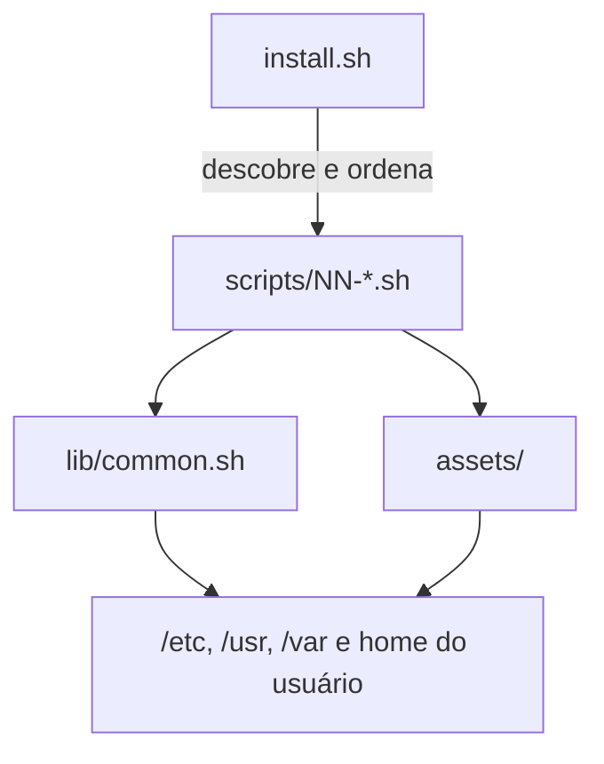
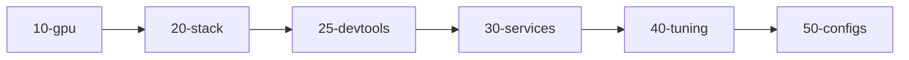

# Arquitetura e etapas

[Português](arquitetura.md) · [English](arquitetura.en.md)

O omyfedora é uma **suíte de scripts bash idempotentes** — não há código compilado, pacote ou
build. O `install.sh` é o orquestrador; `lib/common.sh` concentra os helpers; cada
`scripts/NN-*.sh` é uma etapa; e `assets/` é a fonte da verdade dos arquivos instalados.

## Fluxo de execução



O `install.sh` roda as etapas em ordem lexicográfica. Para adicionar uma etapa, basta criar
`scripts/60-foo.sh`; ela entra no fluxo automaticamente.



## Estrutura do repositório

```text
install.sh              # orquestrador: flags, sudo, ordem das etapas, estado
bootstrap.sh            # baixa o repositório (.tar.gz) e chama o install.sh
lib/common.sh           # logs, dry-run, backups, usuário-alvo, helpers de arquivo
scripts/10-gpu.sh       # detecção de GPU + drivers
scripts/20-stack.sh     # pacotes do stack, curadoria KDE, apps, remoção do Plasma
scripts/25-devtools.sh  # gcc, Rust, Node/nvm, pnpm/yarn, virtualização
scripts/30-services.sh  # greetd, daemons, tuned/oomd, podman rootless, SELinux
scripts/40-tuning.sh    # zram, sysctl, btrfs, governor, oomd
scripts/50-configs.sh   # niri, Noctalia, Breeze, greetd, wallpapers, Zed, zsh
assets/                 # arquivos instalados (configs, helpers, units, wallpapers)
.github/workflows/ci.yml# bash -n, shellcheck e dry-run no Fedora 44
pessoal-pc.sh           # script pessoal (layout de monitores + Chrome), fora do install
```

### O que cada arquivo faz

- **`install.sh`** — parseia as flags, exporta as variáveis, reexecuta com `sudo` quando
  necessário (exceto em `--dry-run`), descobre as etapas, executa uma a uma e registra o
  sucesso em `/var/lib/omyfedora/steps/`. Se uma etapa falhar, mostra o código, o histórico e
  como retomar.
- **`bootstrap.sh`** — baixa o repositório como `.tar.gz`, extrai em um diretório temporário
  e chama o `install.sh`. Não precisa de `git`; aceita `OMYFEDORA_REF`, `OMYFEDORA_REPO`,
  `OMYFEDORA_URL` e `OMYFEDORA_KEEP`.
- **`lib/common.sh`** — carregado por todas as etapas. Define logs, `run_cmd`/`run_sh`
  (respeitam `DRY_RUN`), `exige_ok` (portão de operações destrutivas), `require_fedora`,
  `resolve_target_user`, `user_home`, `install_file`, `install_file_once` e `render_file`.
- **`pessoal-pc.sh`** — script **pessoal**, não executado pelo `install.sh`: aplica um layout
  de dois monitores via `niri msg` e instala/define o Google Chrome. Serve de exemplo de
  configuração de saída; não faz parte do produto instalável.

## `lib/common.sh`

| Função | Papel |
|---|---|
| `log`, `ok`, `warn`, `err` | Mensagens padronizadas (com cor apenas em TTY) |
| `run_cmd` | Executa um comando; em `DRY_RUN=1`, apenas registra o que faria |
| `run_sh` | Executa uma string de shell; também respeita o dry-run |
| `exige_ok` | Bloqueia operação destrutiva sem `--yes` ou confirmação interativa |
| `require_fedora` | Valida `/etc/os-release`, `ID`/`ID_LIKE` e a presença do `dnf` |
| `resolve_target_user` | Resolve `--user`, `SUDO_USER` ou o primeiro UID ≥ 1000 |
| `user_home` | Lê o home do usuário via `getent passwd` |
| `install_file` | Copia um asset para o destino, com backup `.omyfedora-bak`; sempre sobrescreve |
| `install_file_once` | Só instala se o destino não existir — para configs pessoais |
| `render_file` | Copia um asset substituindo `__VAR__` e força modo `0644` |
| `_backup_dst` | Cria o backup da primeira versão de um arquivo sobrescrito |

Detalhes importantes:

- `install_file` usa `install -D -m` para criar diretórios-pai, definir dono/contexto SELinux
  do destino e preservar o modo do asset. Um `cp -a` herdaria o dono de quem clonou o repo.
- `install_file_once` é a garantia de que `~/.config/niri/config.kdl`, `~/.zshrc`, o
  `config.toml` do Noctalia e outros arquivos pessoais **nunca** são sobrescritos.
- `render_file` existe para arquivos que precisam de um valor calculado (por exemplo,
  `__MINFREE__` no sysctl e `__TU_HOME__` no widget do control center).
- `exige_ok` retorna sucesso com `--yes`; em dry-run, bloqueia e registra; em modo interativo,
  pergunta `[s/N]`.

## Variáveis de ambiente

Contrato entre `install.sh`, `bootstrap.sh` e as etapas:

| Variável | Padrão | Efeito |
|---|---|---|
| `DRY_RUN` | `0` | `1` simula tudo, sem escrever, remover ou acessar a rede |
| `YES` | `0` | `1` autoriza operações destrutivas sem perguntar |
| `NO_GREETER` | `0` | `1` não adiciona o repo Terra nem instala o Noctalia Greeter |
| `TARGET_USER` | vazio | Usuário-alvo; se vazio, resolve `SUDO_USER`/UID ≥ 1000 |
| `GPU_PROFILE` | `auto` | `auto`, `intel`, `amd`, `nvidia`, `hybrid` ou `none` |
| `SKIP_REMOVE` | `0` | `1` nunca remove pacotes (inclusive o shell do Plasma e o LibreOffice) |

O bootstrap acrescenta `OMYFEDORA_REF`, `OMYFEDORA_REPO`, `OMYFEDORA_URL` e `OMYFEDORA_KEEP`.
As etapas também leem `FEDORA_VERSION`, exportada por `require_fedora`.

## As seis etapas

### `10-gpu.sh` — detecção e drivers

- Lê `/sys/bus/pci/devices/*` (classe `03xx`) e os módulos já carregados (`nvidia`, `amdgpu`,
  `i915`/`xe`).
- Perfis: `auto` (detecta), `intel`, `amd`, `nvidia`, `hybrid`, `none`.
- **NVIDIA**: tenta o pacote binário `nvidia`; se indisponível, usa `akmod-nvidia`. Adiciona
  `nvidia-drm.modeset=1` ao kernel via `grubby` e instala o `profile.d/omyfedora-nvidia.sh`
  com offload GLX. Em híbrido, mantém a iGPU com Mesa e microcódigo.
- **Intel/AMD**: instala `mesa-dri-drivers` e o microcódigo (`microcode_ctl` ou
  `amd-ucode-firmware`).
- **none**: avisa que a renderização será por software (llvmpipe) — o niri não funciona nesse
  modo por design.

O driver efetivo só vale depois do reboot.

### `20-stack.sh` — stack, apps e curadoria

- **Núcleo**: `greetd`, `niri`, `noctalia`, `jemalloc`, PipeWire/WirePlumber, portais
  (`xdg-desktop-portal` + `-gtk`), polkit/polkit-kde, udisks2/gvfs, NetworkManager, tuned,
  fontes Noto, ícones/cursor Breeze e o tema Plymouth spinner.
- **Energia**: usa `tuned-ppd` se presente; senão instala `power-profiles-daemon`.
- **Utilitários**: alacritty, brightnessctl, playerctl, ntfs-3g, exfatprogs, dosfstools;
  opcionais `swaybg`, `wlsunset`, `ddcutil`, `pipewire-alsa`.
- **Curadoria KDE**: remove jogos (`kmahjongg`, `kmines`, `kpat`), PIM/e-mail (`kmail`,
  `kontact`, `korganizer`, `kaddressbook`, `akregator`), `neochat`, `kmouth`, `kcharselect`,
  `khelpcenter` e o LibreOffice (o escritório do projeto é o ONLYOFFICE). Respeita
  `--skip-remove`.
- **Tema e apps garantidos**: instala `plasma-integration`, `plasma-breeze`,
  `breeze-gtk-common`, `pam-kwallet`, `kde-cli-tools` e `dconf`, além da lista de apps KDE
  (Dolphin, Konsole, KWrite, Okular, Gwenview, Ark, Spectacle, Dragon, Elisa, etc.). Marca os
  apps como `user-installed` para proteger da cascata do dnf e desliga o Baloo.
- **Terminal**: zsh, autosuggestions, syntax highlighting, fzf, bash-completion e fonte
  JetBrains Mono.
- **Contêineres**: `lazydocker` (repo do Fedora ou binário da release com sha256 verificado) e
  `podman-docker`.
- **Bluetooth**: instala `bluez` apenas se houver adaptador.
- **Greeter**: sem `--no-greeter`, adiciona o repo Terra e instala `noctalia-greeter`; se
  falhar, avisa e o greetd usa o greeter padrão.
- **Apps do usuário**: Zed e OpenCode v2 pelos scripts oficiais (com symlink em
  `/usr/local/bin`), Brave e ONLYOFFICE pelos repos oficiais, SSH_Orchestrator pelo RPM da
  release no GitHub e LocalSend pelo flatpak oficial do Flathub.
- **Shell do Plasma**: se não houver `--skip-remove`, pergunta via `exige_ok` e **agenda** a
  remoção para o próximo boot com `omyfedora-remove-plasma.service`. Nunca remove na sessão
  viva.
- **Malcontent**: se o `accounts-daemon` expõe `com.endlessm.ParentalControls`, garante o
  pacote `malcontent` (sem ele todo `flatpak run` falha). Caso contrário, não instala.

### `25-devtools.sh` — ferramentas de desenvolvimento

- `gcc`, `gcc-c++`, `make`, `pkgconf-pkg-config`.
- GitHub CLI (`gh`), `python3-ipykernel` e `python3-matplotlib` (REPL/gráficos do Zed).
- **Rust** via `rustup` em `~/.cargo`.
- **nvm** (última release; fallback fixo) e **Node.js LTS**, com `pnpm` e `yarn` globais.
- **Virtualização**: grupo `@virtualization` (KVM/QEMU, libvirt, virt-manager), `libvirtd`
  habilitado no boot e usuário no grupo `libvirt`. Avisa se `/dev/kvm` não existir.

Tudo é idempotente: detecta o que já existe e pula.

### `30-services.sh` — serviços e login

- Mascara `plasmalogin`, `gdm` e `sddm` (se existirem) e habilita o `greetd`. Nada é parado
  na sessão atual.
- Cria o usuário `greeter` (quando o Noctalia Greeter está disponível), ajusta o contexto
  SELinux `xdm_var_lib_t` para `/var/lib/noctalia-greeter` e aplica `restorecon`.
- Instala o módulo SELinux local `omyfedora-loadkeys-dontaudit`, que silencia o falso positivo
  do `loadkeys` no VT da sessão.
- Desativa `avahi-daemon`, `cups` (o `cups.socket` continua para impressão sob demanda),
  `sssd`, `fprintd`, `dnf-automatic` (+ timer, mascarado), `systemd-pstore`,
  `plasma-setup` (se existir) e `bluetooth` quando não há adaptador.
- Habilita `tuned-ppd` (ou `power-profiles-daemon`), `tuned`, `podman.socket` e
  `systemd-oomd`; cria o symlink de compatibilidade `/var/run/docker.sock` e habilita o socket
  rootless do Podman para o `lazydocker` rodar sem sudo.

### `40-tuning.sh` — memória e desempenho

- **zram**: `/etc/systemd/zram-generator.conf` com `min(ram / 2, 8192)` e compactação `zstd`.
  O próprio generator é executado como sanidade; uma config inválida aborta a instalação.
- **sysctl**: `vm.swappiness=60`, `vm.vfs_cache_pressure=50` e `vm.min_free_kbytes` calculado
  como 1/64 da RAM (limitado entre 8 MiB e 8 GiB).
- **btrfs**: adiciona `compress=zstd:1` ao `/etc/fstab` quando o root é btrfs (com backup).
- **Governor**: fixa `performance` no boot somente em desktops **sem bateria**; com bateria,
  deixa o perfil de energia cuidar.
- **oomd**: aplica `/etc/systemd/oomd.conf` conservador.
- **tuned**: perfil `latency-performance`.

### `50-configs.sh` — configuração final

- **niri**: instala `~/.config/niri/config.kdl` uma única vez e o fallback
  `/etc/xdg/niri/config.kdl` sempre (com backup).
- **Noctalia**: `config.toml` uma vez; `90-greeter-sync.toml` e
  `91-widget-control-center.toml` são atualizados; paletas com backup; `settings.toml` e
  plugins só se ausentes.
- **Breeze Dark**: preenche `kdeglobals`/`kcminputrc` só com chaves vazias; instala
  `gtk-3.0`/`gtk-4.0/settings.ini`, o padrão dconf, o `profile.d/omyfedora-theme.sh` e aplica
  `gsettings` como o usuário.
- **Secret Service (KWallet)**: instala o service de D-Bus
  `~/.local/share/dbus-1/services/org.freedesktop.secrets.service` e recarrega o barramento —
  apps Electron/Tauri ativam o `ksecretd` sob demanda (sem unit systemd; o processo do PAM
  continua residente).
- **Plymouth e marca**: cria o tema de boot `omyfedora` a partir do spinner, troca o watermark,
  instala logo e avatar (`~/.face`).
- **Wallpapers**: instala o helper e as imagens em `/usr/share/omyfedora-walls/`.
- **greetd**: escolhe Noctalia Greeter (com bundle de mascote) ou o greeter padrão; preserva o
  `/etc/pam.d/greetd` do pacote quando ele já tem `pam_selinux`; habilita o sync sem prompt via
  Polkit e dispara o Sync Now.
- **Zed**: instala `assets/zed/` uma vez e o kernelspec `zed-python` do REPL.
- **OpenCode**: clona/atualiza o `agents-config` e roda o `sync.sh`.
- **Padrões**: Brave como navegador; Dolphin, KWrite, Gwenview, Okular, Dragon e Elisa por
  `xdg-mime`.
- **Terminal**: alacritty e `.zshrc` uma vez; define zsh como shell e garante o caminho em
  `/etc/shells` (necessário para o `pkexec` do sync do greeter).
- **Autostart**: instala o seapplet com patch e desliga o XwaylandVideoBridge (`Hidden=true`).
- **Permissões**: ajusta o dono dos arquivos do usuário e dispara o sync final do greeter.

## Assets e propriedade dos arquivos

`assets/` espelha os caminhos de destino e é instalado por `install_file`,
`install_file_once` ou `render_file`. A pasta `assets/selinux/` é a exceção: contém módulos
CIL instalados via `semodule`, não arquivos copiados.

| Tipo | Exemplos | Política |
|---|---|---|
| Config pessoal | `niri/config.kdl`, `noctalia/config.toml`, `.zshrc`, `alacritty.toml`, `zed/*` | `install_file_once` — nunca sobrescreve |
| Config do projeto | `/etc/xdg/niri/config.kdl`, tema GTK/dconf, `profile.d`, wallpapers, helpers | `install_file` — atualiza com backup |
| Estado da GUI | `~/.local/state/noctalia/settings.toml`, plugins | Só instala se ausente |
| Paleta do tema | `~/.config/noctalia/palettes/macOS.json` | `install_file` com backup; para customizar, crie outra paleta |
| Módulos SELinux | `assets/selinux/*.cil` | Instalados via `semodule` |

## Idempotência, backups e estado

- **Toda etapa pode rodar de novo.** A detecção é feita antes de agir (`rpm -q`, `command -v`,
  existência de arquivos/unidades).
- **Backups**: arquivos sobrescritos ganham `.omyfedora-bak` na primeira vez; um backup
  existente nunca é sobrescrito.
- **Estado**: `/var/lib/omyfedora/steps/<etapa>` guarda a data/hora da conclusão. Em dry-run
  nada é gravado.
- **Falha**: o `install.sh` interrompe, mostra o código e orienta a rodar tudo de novo ou só a
  etapa que falhou.
- **Dry-run**: não instala, não remove, não escreve e não acessa a rede. Use
  `DRY_RUN=1 bash scripts/NN-*.sh` para simular uma etapa isolada sem root.

## Segurança de sessão e SELinux

- **Nada é parado durante a instalação.** Mascarar o plasmalogin/gdm/sddm e habilitar o greetd
  só vale no próximo boot.
- **Remoção do Plasma no boot**: o `%preun` do plasmalogin/plasma-* mexe nos serviços systemd e
  derrubaria a sessão no meio da transação dnf. Por isso a remoção é feita pelo
  `omyfedora-remove-plasma.service`, antes do login. O script move temporariamente a proteção
  do dnf, protege os pacotes que mantêm os apps KDE funcionais e, se falhar, tenta de novo no
  boot seguinte.
- **PAM**: o `/etc/pam.d/greetd` precisa de `pam_selinux`; sem ele o `systemctl --user` da
  sessão é negado e o niri volta para o login. O instalador preserva o arquivo do pacote e só
  restaura a versão do projeto se detectar uma versão antiga sem `pam_selinux`.
- **SELinux**: o contexto do home do greeter (`xdm_var_lib_t`) e o módulo
  `omyfedora-loadkeys-dontaudit` evitam AVCs/falsos positivos no login.

## Decisões de projeto

| Decisão | Motivo |
|---|---|
| **Rota C** (script sobre Fedora existente) | Sem ISO, sem infraestrutura de build; usa a base e o hardware já instalados |
| **Manter apps KDE** | O usuário ganha o desktop enxuto sem perder Dolphin, Konsole, Kate, Okular etc. |
| **Breeze Dark** | É o dark padrão do KDE; os apps continuam consistentes com o ecossistema |
| **Noctalia em duas camadas** | Estilo no `config.toml`, estado da GUI no `settings.toml`; personalização da GUI sobrevive |
| **Configs pessoais uma vez** | Uma reexecução do instalador não come atalhos, temas e ajustes do usuário |
| **Nada é parado na sessão viva** | Evita derrubar o instalador e a sessão no meio de uma transação dnf |
| **Sem atualização automática** | O usuário controla quando atualizar (o `dnf-automatic` é desativado) |

## Verificação e CI

Não há `package.json`, `Makefile` ou testes automatizados no repo. A verificação local é:

```bash
# bash -n com vários arquivos só valida o PRIMEIRO (os demais viram $1, $2...).
# Por isso o loop, e o filtro de shebang (assets/bin/omyfedora-seapplet é Python).
scripts=()
for f in install.sh bootstrap.sh pessoal-pc.sh lib/common.sh scripts/*.sh assets/bin/* assets/libexec/*; do
  first="$(head -n1 "$f")"
  case "$first" in
    *bash*|*'/sh'*|*dash*|*ksh*) scripts+=("$f") ;;
  esac
done
for f in "${scripts[@]}"; do bash -n "$f" || exit 1; done

shellcheck -S warning "${scripts[@]}"
./install.sh --dry-run
```

O CI em `.github/workflows/ci.yml` roda três jobs em `fedora:44` a cada push/PR:

1. **sintaxe** — `bash -n` em todos os arquivos com shebang shell.
2. **lint** — `shellcheck -S warning`.
3. **dry-run** — cria um usuário `ci` (UID 1000) e roda `./install.sh --dry-run --user ci`.

## Desenvolvimento: adicionar uma etapa

1. Crie `scripts/60-foo.sh` com `#!/usr/bin/env bash`, `set -euo pipefail` e o `source` do
   `lib/common.sh`:

   ```bash
   #!/usr/bin/env bash
   # 60-foo.sh — o que a etapa faz.
   set -euo pipefail
   source "$(cd "$(dirname "${BASH_SOURCE[0]}")/.." && pwd)/lib/common.sh"
   require_fedora
   ```

2. Use `run_cmd`/`run_sh` para qualquer ação que altere o sistema e `install_file`/
   `install_file_once`/`render_file` para arquivos. Nunca `cp` direto.
3. Respeite as variáveis `DRY_RUN`, `YES`, `SKIP_REMOVE`, `TARGET_USER` e `GPU_PROFILE` quando
   fizer sentido.
4. Encerre com `ok "..."`; falhas essenciais usam `err ...; exit 1`; pacotes opcionais usam
   `|| warn ...`.
5. Teste:

   ```bash
   DRY_RUN=1 bash scripts/60-foo.sh
   bash -n scripts/60-foo.sh
   shellcheck -S warning scripts/60-foo.sh
   ./install.sh --dry-run
   ```

Convenções: tudo em português (comentários, logs e mensagens), Bash estrito, `dnf` com
`--setopt=install_weak_deps=0`, comandos como o usuário-alvo via `runuser -u ... -- env
HOME=...`, e `# shellcheck disable=SCxxxx` quando o lint reclamar de forma justificada. O
`install.sh` executa as etapas com `bash`, então o bit de execução não é obrigatório, mas os
scripts do repo são executáveis por convenção.
